# 📊 Personal GitHub Stats Generator

A lightweight, modular, and dependency-free GitHub stats generator built from scratch with **TypeScript**, **Node.js**, and the official **GitHub GraphQL API**.

Generates 3 customizable, responsive SVG cards for your GitHub Profile README and updates them automatically via **GitHub Actions**:
1. **GitHub Overview Card** (Stars, Commits, PRs, Issues, Contributed Repositories)
2. **Contribution Streak Card** (Total Contributions, Current Streak with grace period, All-time Longest Streak)
3. **Most Used Languages Card** (Proportional multi-segment progress bar & legend)

---

## 🎨 Card Previews

<div align="center">
  
  <br /><br />
  
  <br /><br />
  
</div>

---

## ✨ Features & Architecture

- **No Third-Party Services:** Directly queries official GitHub GraphQL APIs without relying on external SaaS or shared rate-limited endpoints.
- **Serverless / Zero Runtime Cost:** Runs locally or on a GitHub Actions cron schedule. No continuously running backend or database.
- **Atomic File Preservation:** SVGs are written to temporary staging files (`.tmp`) first and validated before atomically replacing existing cards. If an API request fails, your existing cards remain untouched.
- **Dual Streak Modes:** Supports both 1-year rolling calendar and multi-year historical retrieval (back to account creation date) to calculate your true all-time longest streak.
- **Private Activity Support:** Seamlessly includes private contributions and commits when given a token with `repo` and `read:user` scopes.
- **Morning Grace Period:** Ensures your active streak doesn't reset to `0` in the morning before your first commit of the day.
- **Pure SVG Generation:** Hand-crafted, lightweight XML templates with scoped styling and XML entity escaping. No bloated headless browsers (Puppeteer) or DOM parsers.
- **Pluggable Themes:** Choose from built-in themes (`github-dark`, `tokyo-night`, `dracula`, `minimal-light`) or add your own palette.

---

## 🏗️ Architecture & Modules

```
┌─────────────────┐       ┌────────────────────────┐       ┌──────────────────────┐       ┌─────────────────────┐
│  Configuration  │  ──>  │ Data Fetcher (Octokit) │  ──>  │   Metrics Engine     │  ──>  │    SVG Renderer     │
│  & Environment  │       │  (GraphQL API Client)  │       │   (Pure Functions)   │       │ (Pure SVG Builders) │
└─────────────────┘       └────────────────────────┘       └──────────────────────┘       └──────────┬──────────┘
                                                                                                     │
                                                                                          ┌──────────▼──────────┐
                                                                                          │    Atomic Writer    │
                                                                                          │  (Preserve on Fail) │
                                                                                          └─────────────────────┘
```

- **`src/config/`**: Typed environment variable parsing, validation, and defaults.
- **`src/api/`**: Octokit GraphQL client with auto-pagination for repositories (>100 repos) and historical yearly queries.
- **`src/metrics/`**: 100% pure deterministic business logic calculating overview totals, streaks, and language byte percentages.
- **`src/render/`**: Native SVG templates, color themes, inline vector icons, and segmented progress bars.
- **`src/storage/`**: Atomic file staging and error-safe disk writes.

---

## 🚀 Quickstart & Local Development

### 1. Prerequisites
- **Node.js 20+**
- **npm 10+**

### 2. Clone and Install
```bash
git clone https://github.com/your-username/readme-stat.git
cd readme-stat
npm install
```

### 3. Test Offline (Mock Mode)
You can run the generator immediately without setting up a token:
```bash
npm run dev:mock
```
This will read the fixture datasets in `tests/fixtures/` and output all 3 SVGs to `./generated/`.

### 4. Run with Live GitHub Data
1. Copy the environment template:
   ```bash
   cp .env.example .env
   ```
2. Create a GitHub Personal Access Token (PAT):
   - **For public activity only:** Fine-grained PAT with `User profile: Read-only` or Classic PAT with `read:user`.
   - **To include private contributions:** Classic PAT with `repo` and `read:user` (or Fine-grained PAT with Contents: Read, Metadata: Read, Profile: Read).
3. Set your token in `.env`:
   ```ini
   GITHUB_TOKEN=ghp_yourPersonalAccessTokenHere
   GITHUB_USERNAME=your-username
   CARD_THEME=github-dark
   FETCH_MULTI_YEAR=true
   ```
4. Run the generator:
   ```bash
   npm run dev
   ```

---

## 🤖 GitHub Actions Automation

The repository includes a ready-to-run GitHub Action in [`.github/workflows/update-stats.yml`](.github/workflows/update-stats.yml).

### Setup Instructions:
1. Push this repository to GitHub.
2. Go to **Settings** > **Secrets and variables** > **Actions** in your GitHub repository.
3. Click **New repository secret**:
   - **Name:** `GH_STATS_TOKEN`
   - **Value:** Your GitHub Personal Access Token (with `repo` and `read:user` permissions).
4. (Optional) Go to **Variables** tab to customize options:
   - `CARD_THEME`: `github-dark` | `tokyo-night` | `dracula` | `minimal-light`
   - `FETCH_MULTI_YEAR`: `true` | `false`
   - `TIMEZONE`: `UTC` | `Asia/Kolkata` | `America/New_York`
5. Go to the **Actions** tab, select **Update GitHub Stats Cards**, and click **Run workflow** to test manual execution.
6. The workflow will run automatically every day at `00:00 UTC` and commit changes only when stats have updated.

---

## 📌 Embedding in your Profile README

Add the generated SVG cards into your `README.md`:

```markdown
### 📈 GitHub Statistics

<div align="center">
  /<REPO_NAME>/main/generated/overview.svg" alt="Overview" width="480" />
  <br /><br />
  /<REPO_NAME>/main/generated/streak.svg" alt="Streak" width="480" />
  <br /><br />
  /<REPO_NAME>/main/generated/languages.svg" alt="Languages" width="480" />
</div>
```

> **Tip:** If GitHub's image cache (Camo) serves a stale card, append a cache-buster query parameter to the URL in your README (e.g. `streak.svg?v=1`) to force an immediate refresh.

---

## 🧪 Testing

The test suite uses [Vitest](https://vitest.dev) for testing:

```bash
# Run all unit tests
npm test

# Run tests in watch mode
npm run test:watch
```

---

## 📄 License
MIT
